# Interfaz de escritorio y Windows

**Propuesta de luchoberaza para revisar en el PR.** La app vive en `app/`, el núcleo corre también en Windows y la terminal (`pi-learn`) queda igual. Las decisiones están en `DECISIONES.md` (DA39–DA56). Sin commits del lado del autor: el dueño del repo decide.

## Qué trae

- **Una app de escritorio** (Electron) para Windows y Linux. Usa learn entero sin comandos.
  - **Inicio:** «Seguir la clase» donde quedaste, con la última frase del tutor; el índice de cada curso como el de un libro; tu semana de foco.
  - **La clase:** se lee como un libro anotado. Literata a 18 px. Las citas `[[…pdf#page=N]]` van al margen con la miniatura de la página. El quiz está dentro del texto (teclas a, b, c y n), con fórmulas y diagramas.
  - **Panel de página** con las reglas de `ver_pagina`.
  - **El PDF entero:** cada documento del curso, en la página citada, en una pestaña o en su propia ventana, como se elija al abrirlo. Trae búsqueda, miniaturas y texto seleccionable. Las páginas reservadas para el simulacro llegan en blanco (DA47, DA56).
  - **Pestañas,** como en un navegador: una conversación o un PDF en cada una. Al volver a una pestaña, pi vuelve a su conversación; si el tutor está respondiendo, antes pregunta. Al abrir la app vuelven las pestañas que había (DA56).
  - **La barra lateral se pliega** (Ctrl+B), y ella y el panel de página se ensanchan arrastrando su borde (DA54).
  - **Tamaño de la interfaz** de 80 a 150 %, en Ajustes o con Ctrl + y Ctrl −, en todas las ventanas (DA55).
  - **Simulacro** con el reloj proporcional del examen.
  - **Temporizador de foco** que nunca corta la clase.
  - **Paleta** (Ctrl+K) con todos los comandos de learn, de las skills y de pi.
  - **Más pantallas:** «Preparar la computadora» (el doctor con un botón por faltante), Crear curso y Agregar material, Tema libre, lector de notas y Ajustes.
  - **Eliminar un curso** desde su pantalla: va a la papelera del sistema, de donde se restaura, y no se elimina con una clase abierta, la ingesta o la preparación corriendo (DA53).
  - **Subagentes** en paneles propios, sin tmux.
  - **Medidor de consumo:** en la barra lateral, lo que queda en la cuenta del modelo de la clase (dólares del plan, % de la ventana de la suscripción o pedidos gratis del día) y cuántas consultas alcanzan; un clic para cambiar de modelo, y un aviso con otro modelo cuando se está por acabar. En Ajustes → Consumo, el plan de cada cuenta, lo gastado por día y por modelo, y cuánto rinde cada modelo. Los modelos gratis (DeepSeek o Qwen por OpenRouter, NVIDIA y otros) se cuentan en pedidos y tokens (DA48).
- **El modelo principal de cada máquina**, que ya no vuelve al del repo en cada sesión nueva, también en la terminal (DA49).
- **Un tutor que no da nada por sabido** (DA52), también en la terminal:
  - el diagnóstico vuelve a ser el de `teach`, sin tope, y arranca con una lista de lo que el alumno ya vio;
  - antes de usar un término o una definición del libro, el tutor comprueba que el alumno lo tiene;
  - cada pregunta llega con la explicación que verifica, escrita antes de ella: en una clase real el tutor la escribía en su razonamiento, que el alumno no ve;
  - cada tema se puede encarar como siempre, desde cero o para fortalecer lo flojo;
  - el alumno elige cuántas preguntas van de múltiple opción y cuántas de desarrollo, con una pregunta nueva que se responde escribiendo.
- **La ingesta base, entre 3 y 4,5 veces más rápida:** procesa varias páginas a la vez según los hilos de cada máquina, deja media máquina libre y corre con prioridad baja. Los archivos que deja son idénticos a los de antes (DA50).
- **El núcleo en Windows:**
  - bloqueos, procesos y rutas portables;
  - el researcher con un vigilante en Node;
  - la configuración por máquina;
  - el doctor por plataforma;
  - `visualize` dibujando con Chrome, Chromium o Edge.
- **Un puente para quiz y preguntas** fuera de la terminal (`ctx.ui.preguntar`) y **una sola tabla de etiquetas** para las dos interfaces.

## Cómo se ve

Capturas de las pruebas de punta a punta, con el curso de demostración y el tutor simulado.

**Inicio.** Volver a la última clase, con su última frase; el índice del curso como el de un libro y la semana de foco.

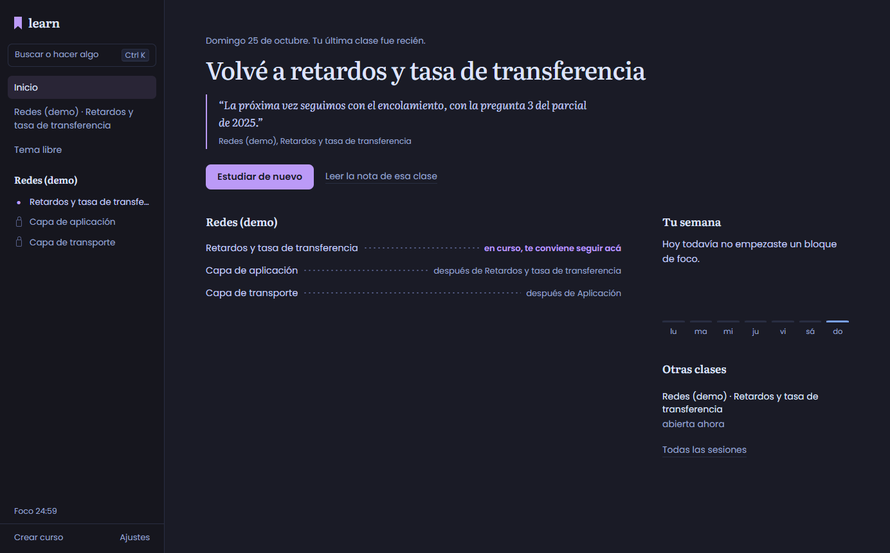

**La clase.** La cita va al margen con la miniatura de la página; el quiz, dentro del texto, con fórmulas.

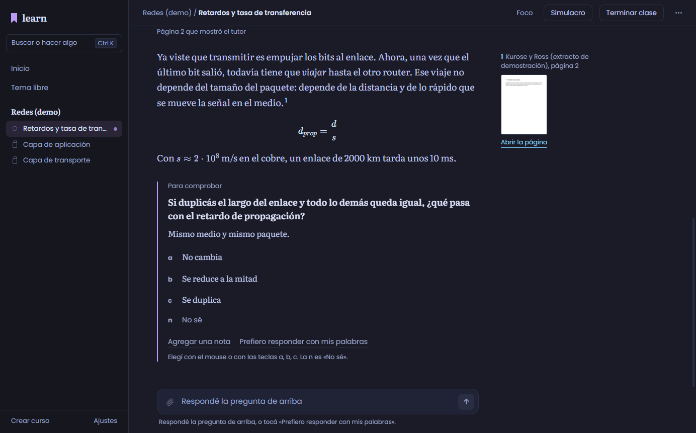

**Corrección, plan y diagrama.** La correcta llega recién después de responder; el plan aprobado y un bloque Mermaid del tutor, dibujado en la clase.

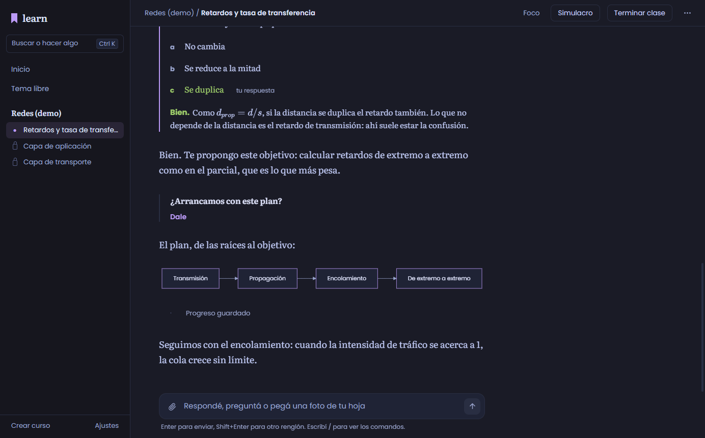

**Panel de página.** La página original, fijable, con las reservadas para el simulacro salteadas.

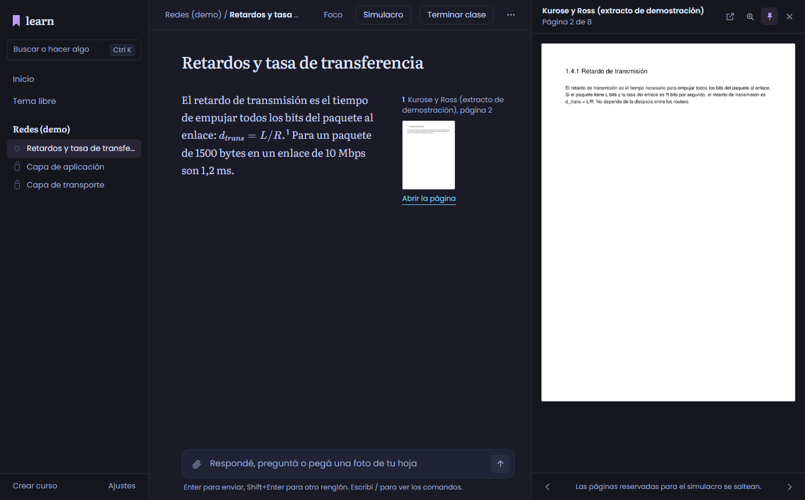

**Ventana de PDF.** El libro entero, abierto en la página citada, con la búsqueda sin distinguir tildes. Se puede mover a otro monitor y cerrar.

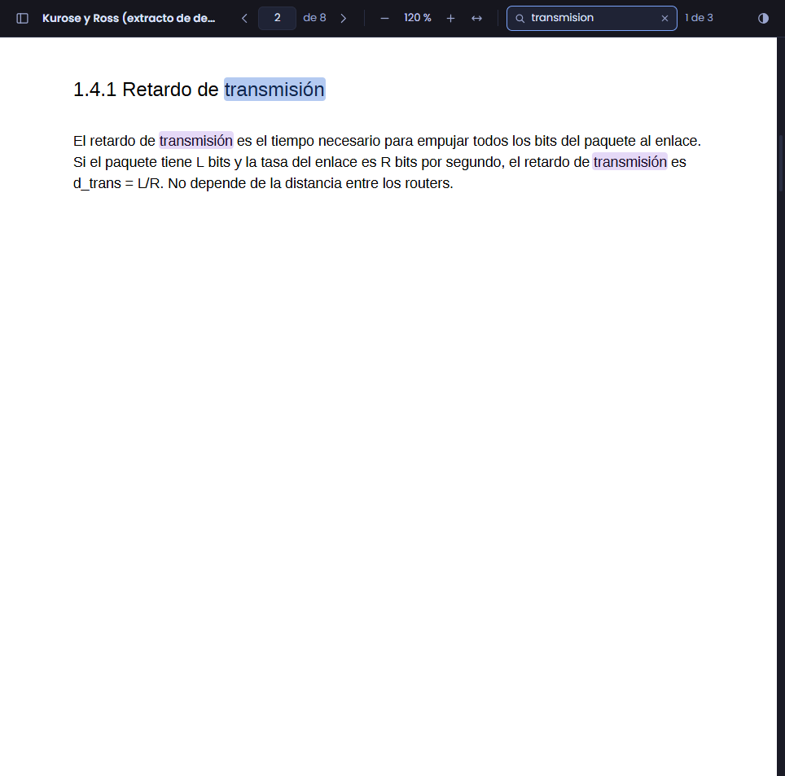

**Pestañas.** La clase, otra conversación y el libro, cada uno en su pestaña. Al abrir el PDF entero se elige si va en una pestaña o en una ventana.

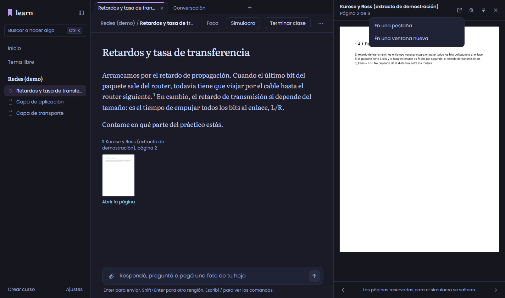

**El PDF en una pestaña.** El mismo lector de la ventana, sin las páginas reservadas para el simulacro. Al volver a la clase, sigue donde estaba.

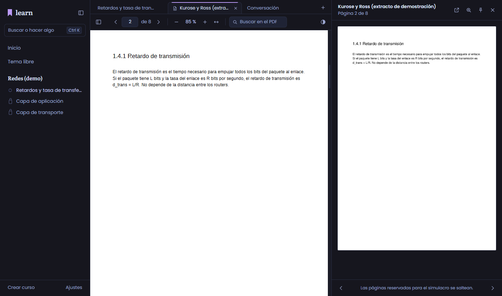

**Medidor de consumo.** Abajo en la barra lateral: el modelo de la clase, lo que queda en su cuenta y cuántas consultas alcanzan. Un clic abre los modelos de las cuentas conectadas, cada uno con lo que rinde.

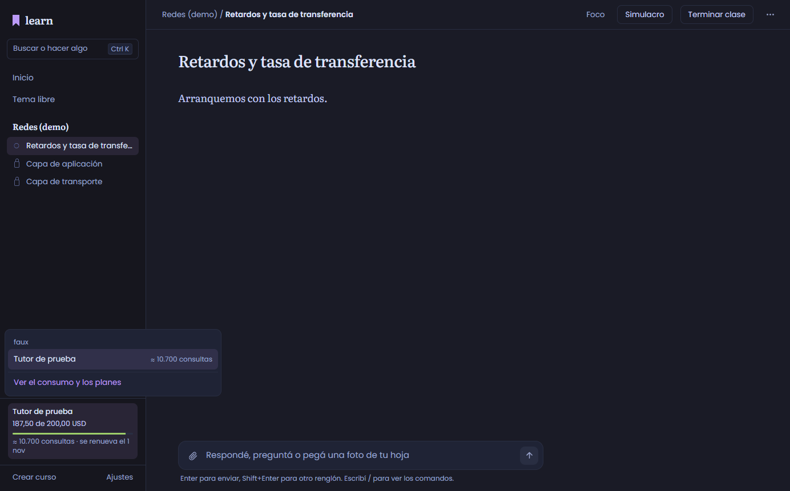

**Ajustes → Consumo.** El plan de cada cuenta (para Claude, entre otros, los créditos de los planes Max), lo gastado por día, lo usado con cada modelo y cuánto rinde cada uno con lo que queda.

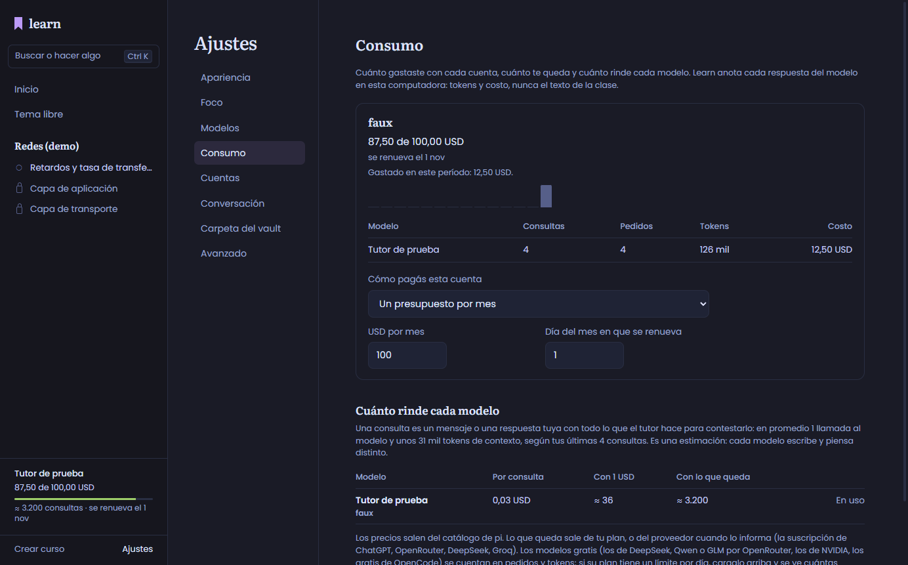

**Simulacro.** El reloj proporcional del examen en la barra de la clase.

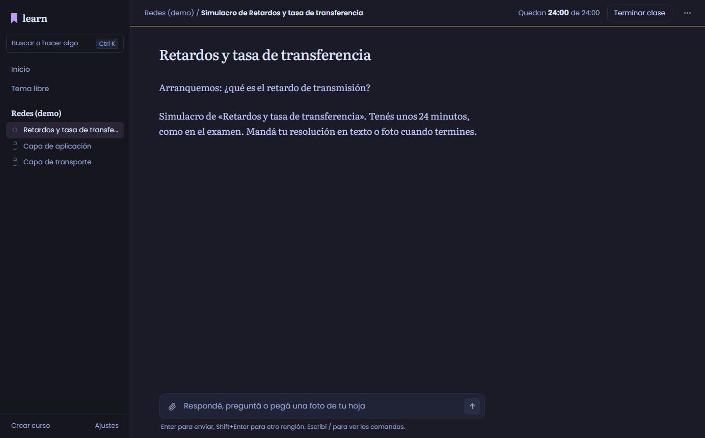

**Vista del tema.** Próximo paso, objetivo, plan, lo dominado y lo que todavía falla, de `progreso.yaml`.

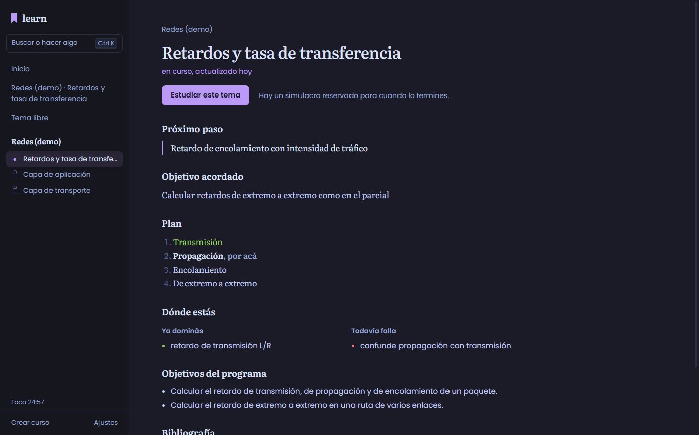

**Paleta (Ctrl+K).** Cualquier comando de learn, de las skills o de pi, sin escribirlo entero.

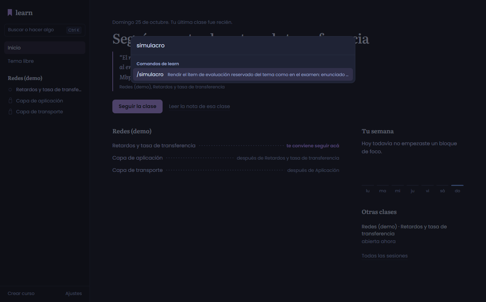

**Modo Día.**

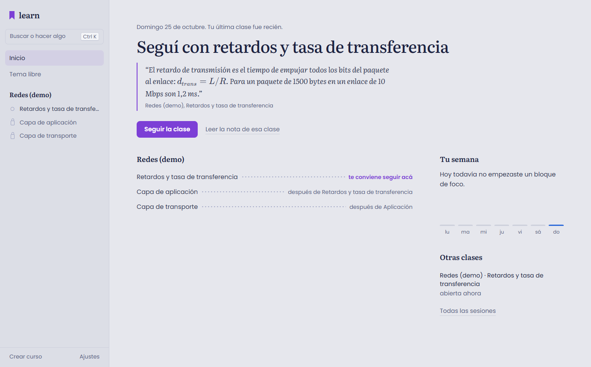

**En Linux** (Ubuntu sobre WSL, la misma clase).

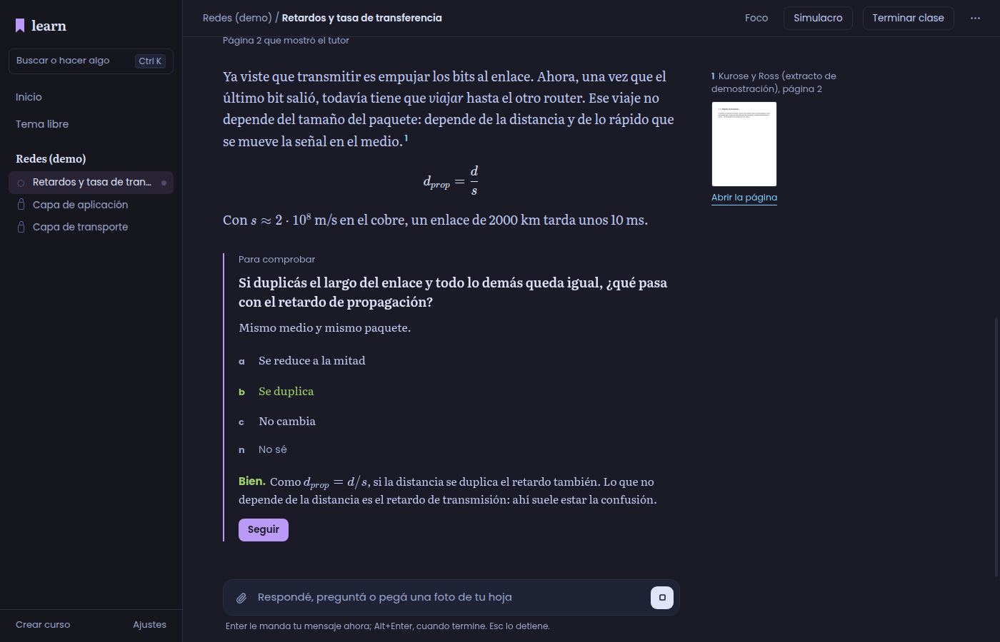

## Contra lo que hay hoy (nada se pierde)

| Hoy en la terminal | En la app |
|---|---|
| `pi-learn`, `pi-learn -c`, `--resume`, `/resume` | abrir la app; Inicio, «Seguir la clase»; «Todas las sesiones» |
| `/cursos`, `/estudiar [curso] [tema]`, selector de temas | barra lateral y vista del tema, en el orden de `ordenarTemas`; buscador del curso con cualquier texto (alias, BM25, ad hoc) |
| `/estudiar … desde-cero`, `/estudiar … fortalecer` (DA52) | «Desde cero» y «Fortalecer lo flojo» en la vista del tema, con lo que hace cada uno; el segundo, sólo con algo guardado que falle |
| `/preguntas` (DA52) | Ajustes → Cómo estudio |
| cambio de tema con clase abierta, tema fuera del índice | los mismos diálogos de la extensión («Guardar y cambiar»…) |
| quiz, `ask_user_question` (single, multi, «Otra», texto), Esc | tarjetas dentro del texto; «Prefiero responder con mis palabras» |
| `pregunta_desarrollo` (DA52): escribir, «No sé», Esc | tarjeta con una caja para escribir, «No sé» y «Prefiero responder en el chat»; la respuesta esperada aparece recién al responder |
| confirmaciones «Sí, … / No» | diálogo con las mismas opciones; cerrar vale como No |
| fotos (Ctrl+V, ruta) | pegar, arrastrar o elegir; HEIC y BMP como ruta, como en la terminal |
| `ver_pagina`, citas | página en la clase, notas al margen, panel fijable y el PDF entero en su ventana, sin las páginas reservadas |
| barra «📚 curso › tema», «📝 Simulacro» | barra de la clase; reloj del examen en el simulacro |
| preparación, verificación, ingesta | línea de estado y barra de avance en la barra lateral |
| errores en español y «seguí» | línea de error con «Reintentar» |
| `/simulacro`, `/fin`, `/progreso` | botones Simulacro y Terminar clase; vistas del curso y del tema |
| `/compact`, `/md-log`, `/md-unlog` | menú de la clase |
| `/curso-nuevo`, `/curso-agregar`, diff de `guardar_curso` | Crear curso y Agregar material; el diff en el diálogo de confirmación |
| `/curso-check`, `/curso-estado`, informe de ingesta | pestaña Estado del curso |
| notas en Obsidian | lector de notas y «Abrir en Obsidian» |
| `/skill:teach`, `visualize` | Tema libre; los diagramas como imágenes |
| subagentes en tmux | paneles con terminal real (DA45) |
| herramientas generales (bash, edit…) | línea plegable con la entrada y la salida |
| `/login`, `/logout`, `/model`, `/thinking`, `/settings` | Ajustes: Cuentas, Modelos (también visión y researcher), Consumo, Conversación; el modelo también desde el medidor de la barra |
| `/new`, `/tree`, `/fork`, `/clone`, `/import`, `/export`, `/copy`, `/name`, `/session`, `/reload`, `/trust`, `/hotkeys`, `/changelog`, `/quit` | menú de la clase, paleta y diálogos propios |
| `/share`, `/bug`, `/llama` | avisan que siguen en la terminal |
| `doctor` | «Preparar la computadora» |

## Cómo funciona

La ventana no corre pi. Un proceso aparte (`app/host`) la corre con el Node del sistema y la misma instalación de pi 1.4.0 de la terminal, con el `.pi/` del vault, sin bifurcar nada. Arma la sesión como `pi-learn` (`-ns --skill .pi/skills`, `PI_OFFLINE` si faltan paquetes) y trabaja desde la carpeta del vault.

**Qué ve la ventana.** Lo decide un filtro, campo por campo. Nunca llegan:

- los argumentos ni los resultados de las tools del curso (salen sus líneas en español, de `etiquetas.ts`);
- la correcta ni la explicación de un quiz antes de responder (la corrección la arma el host);
- la respuesta esperada de una pregunta de desarrollo antes de responder;
- los mensajes ocultos;
- el razonamiento;
- el `SKILL.md` de una skill cargada.

El panel de página aplica las reglas de `ver_pagina`. La ventana de PDF también: no recibe el PDF original sino una copia con cada página vedada en blanco, y los parciales y las soluciones no se abren enteros. Los datos del curso salen de `sesion.py cargar`, en sólo lectura.

## Pruebas

Sin modelo ni red: el proveedor falso de pi-ai con guion hace de tutor. Windows 11 con Node 24.12; Linux con Ubuntu en WSL, Node 26.1 y Electron sobre WSLg.

| Suite | Windows | Linux |
|---|---|---|
| Node de learn (`tests/*.test.mjs`) | 317: 295 en verde, 0 en rojo, 22 salteadas con motivo | 317: 304 en verde, 0 en rojo, 13 salteadas con motivo |
| Python de learn (`tests/ingesta`) | 175: 169 OK, 6 salteadas | 175: 171 OK, 4 salteadas |
| App: host y lógica (`npm test`) | 50: 46 en verde, 4 salteadas (piden el curso de demostración en el vault) | 50 de 50 |
| App: punta a punta con Electron (`npm run e2e`) | 19 de 19 | 19 de 19 |
| App empaquetada (instalador NSIS / AppImage) | una clase, el PDF en una pestaña y en una ventana, la barra plegada y la escala | lo mismo |

Las filas de la app son del 2026-10-28, con DA54–DA56. En Windows, las de punta a punta corrieron contra un vault de prueba con el curso de demostración (`LEARN_E2E_VAULT`). Después del último ajuste (la pestaña de PDF ya no redibuja la ventana al pasar de página) se repitieron las de pestañas, más la ventana de PDF en Linux. La app empaquetada se probó con los dos instaladores de la release `learn-app-0.1.0`, armados desde `ebd9b84`. En Windows también se instaló encima y abrió con un vault real. Las filas de learn son de antes: DA54–DA56 no tocan el núcleo.

**Con el modelo real** (Claude Sonnet 5.5, en Windows, el 2026-10-26). Tres clases en la app con un alumno virtual, con un registrador entre pi y Anthropic que anota lo que factura cada respuesta:

- La app anda de punta a punta: el diagnóstico inicial, el quiz y las preguntas con su corrección, el verificador en segundo plano, el progreso guardado y la nota en Obsidian. El tutor tardó unos 5 s por respuesta.
- Una clase de 10 intervenciones con su cierre costó 0,19 USD; el verificador del tema, una vez, 0,08; una página de visión, 0,01. Cada intervención del alumno cuesta unos 0,018 a 0,019 USD (1,3 a 1,5 llamadas al modelo).
- El registro de learn (DA48) coincidió con lo facturado llamada por llamada: 19 llamadas y 0,2875 USD en una clase, 14 llamadas y 0,2088 USD en otra, separadas en clase, preparación y verificador.
- Las dos últimas arrancaron con Claude sólo por `modelo_principal` (DA49), con el repo fijando `openai-codex`.

**Línea de base en Windows, antes de los cambios:** 147 tests Node en verde y 119 en rojo; la suite Python casi entera en rojo.

**Las salteadas, todas con su motivo en la salida:**

- 10 necesitan el curso real de Redes (no está en el repo).
- 9, sólo en Windows, son del lanzador `pi-learn` (fish + tmux).
- Las demás dependen de algo que esa máquina no tiene: ImageMagick con HEIC, `chmod` de carpetas o espacios de nombres en Windows, un Chrome en el Linux de prueba.
- Las dos de diagramas de Linux pasaron aparte con un Chrome real.
- La de Python con el modelo real de transcripción (DA51) necesita el modelo descargado y una grabación en `LEARN_GRABACION_REAL`; pasó aparte en las dos.

**Las pruebas de punta a punta recorren:**

- una clase entera: lectura del libro, página mostrada, cita al margen con miniatura, fórmulas, quiz sin la correcta antes de responder, corrección, aprobación del plan, diagrama, plan guardado, foco, Terminar clase con nota y progreso, Inicio con «Volvé a…» y la vista del tema;
- el panel de página (avanzar, fijar, Esc), la paleta y el modo Día;
- la ventana de PDF: abre en la página citada, busca sin distinguir tildes, muestra en blanco la página del problema reservado, se recarga cuando lo reservado cambia, no se duplica y se cierra con la ventana principal;
- la ventana de grabación (DA51): la cita abre la grabación en su segundo, se puede adelantar, otra cita reusa la ventana, no sirve a un permiso ajeno y se cierra con la principal;
- el simulacro con su confirmación y el reloj del examen;
- un barrido de todas las pantallas sin botones sin nombre ni errores de consola;
- tema libre con su nota;
- crear curso desde un PDF;
- un subagente real en su panel;
- el buscador del curso con un alias;
- el medidor de consumo: lo que queda según el plan, la lista de modelos, la clase sumada al registro y al uso por modelo, y el plan cambiado desde Ajustes;
- Cómo estudio y los modos (DA52): la mezcla guardada en `curso.config.local.json` sin tocar lo demás, «Desde cero» y «Fortalecer lo flojo» en el tema, y una clase desde cero con una pregunta de desarrollo. La respuesta esperada no se ve antes de responder, queda en la transcripción y en la nota, y el tutor falso comprueba que le llegan el modo, la mezcla y el conteo;
- eliminar un curso (DA53): frena con una clase abierta en la app o en otro pi; la confirmación cuenta qué se va y arranca en «Cancelar»; el curso va a la papelera con su manifiesto y su propuesta, y «Seguir donde quedaste» retoma la clase anterior. Se agregó después de la tabla de arriba, que no se volvió a correr entera; esta prueba y la de la clase entera pasan en las dos, y la papelera real de cada sistema se probó aparte;
- pestañas, paneles y escala (DA54–DA56):
  - dos conversaciones en dos pestañas, cada una con la suya al volver, y dos clases de temas distintos en dos pestañas;
  - la pregunta antes de cortar al tutor;
  - el PDF en una pestaña, sin la página reservada y con la clase intacta al volver;
  - lo que se restaura al abrir;
  - la barra lateral plegada y arrastrada, el panel de página arrastrado y la escala contra el zoom real de la ventana.

**Errores encontrados al verificar, y corregidos:**

- **Mensajes del tutor:** dos que compartían milisegundo se pisaban. Ahora cada uno lleva su id.
- **Diálogos:** los de las extensiones no se cerraban al responder.
- **«Seguir donde quedaste»:** salteaba las clases cerradas con `/fin`.
- **El host:** corría con el directorio de Electron, y los subagentes no encontraban sus agentes.
- **Terminal de los subagentes:**
  - Git Bash descartaba lo escrito antes de su prompt;
  - un panel cortado en Windows daba un código negativo que el paquete no reconoce.
- **Skills:** el `SKILL.md` aparecía como mensaje del alumno.
- **`visual-tools`:**
  - su lock no se podía instalar fuera de la máquina de su autor;
  - buscaba Chrome sólo en macOS;
  - unía el PATH con `:`.
- **Detalles de pantalla:**
  - la fecha del progreso salía corrida un día;
  - los avisos tapaban la caja de texto;
  - las fórmulas de la última frase salían en crudo;
  - el reloj de foco arrancaba en 25:01.

## Lo que falta

- **Probar con `openai-codex`**, la cuenta del dueño, en Omarchy: con el modelo real se probó Claude Sonnet 5.5 en Windows. Con esa cuenta se ven por primera vez las ventanas de la suscripción en el medidor.
- **Subagentes con otra cuenta:** scout, worker, mermaid-maker y svg-maker tienen `openai-codex` fijo en `agents/*.md`; con sólo Claude no arrancan.
- **Subagentes:** decidir un fork fijado de `pi-interactive-subagents` o un PR a su autor, para no depender del parche local (DA45).
- **Probar en Omarchy mismo** (Hyprland, Wayland). Linux se probó en Ubuntu sobre WSL.
- **Medir DA50 con un libro real.** Los tiempos de la ingesta se midieron con PDFs sintéticos. La preparación con el modelo de visión sigue de a una página.
- **Grabaciones con placa NVIDIA (DA51):** el camino con CUDA no se probó, porque ninguna máquina de prueba tiene una. Sin placa, una grabación de 41 minutos llevó 23.
- **Instaladores sin firma.** El AppImage pide `--no-sandbox` en distros que restringen los espacios de nombres (Ubuntu 24.04); en Arch no.
- **`.pi/settings.json`** sigue con la entrada de ponytail del dueño. En una máquina sin ese paquete, pi intenta clonarlo al arrancar. Se propone moverla a su configuración personal; no se tocó.
- **Dos avisos de severidad baja** de `npm audit` en KaTeX (dentro de Mermaid), en la interfaz. Requieren una contaminación de prototipo previa y la opción `trust` de KaTeX, que la app no usa. Las dependencias que van en el instalador no tienen avisos.

## Propuestas para después (no implementadas)

- **Repaso espaciado:** traer de vuelta errores de concepto y nodos dominados con el tiempo; los datos ya están en `progreso.yaml`.
- **Mapa del curso** como grafo de prerequisitos, con el estado de cada tema.
- **Foco por tema:** minutos de foco y aciertos del quiz por tema, en la vista del tema.
- **Simulacro de varios temas**, o de un parcial entero (H58).
- **Lectura:** tamaño de letra y ancho de columna configurables.
- **Búsqueda** en todas las notas de clase.
- **Avisos del sistema** cuando termina una ingesta o una preparación con la app minimizada.
- **Actualizaciones automáticas** de la app, con instaladores firmados.

## Cómo probarla

```bash
cd ~/Projects/pi-learning
.pi/.venv/bin/python .pi/app/e2e/curso_demo.py --vault .   # el curso de demostración que usan las pruebas
cd .pi/app
npm ci
npm run dev        # la app
npm test           # host y lógica
npm run e2e        # punta a punta
npm run empaquetar # AppImage (o instalador NSIS en Windows)
```
